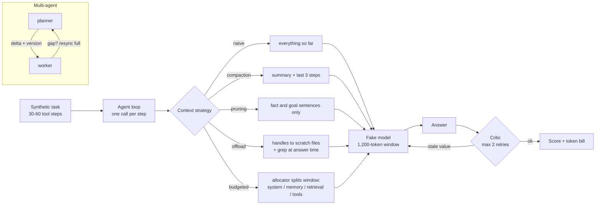

# Jagadish-context-engineering

**Context engineering lab: what an agent should see on each model call, measured as accuracy vs tokens.**

> **Recruiter summary.** Long-running agents fail when old facts fall out of the context window or get buried in noise.
> This repo builds the fixes: a token budget allocator, history compaction, tool-result pruning, scratch-file offloading,
> delta hand-offs between agents and a critic loop with a hard retry cap. All of them run against the same 40 synthetic
> 30-60 step tasks with a deterministic fake model. In this simulation, the combined strategy scores 97.5% at 0.27x the
> tokens of naive full context, which scores 0%. Every number below comes from `ctxeng demo`, and CI checks them on each push.

All results are **simulated**: the model is a deterministic fact reader with modelled weaknesses, not an LLM.
40 tasks is a regression set, not a quality claim; confidence intervals are shown so you can see how wide they are.

## Purpose and who it is for

- **Engineers building agents**: a small, readable reference for each context technique with a test that pins its behaviour.
- **Interviewers and recruiters**: one table that shows the trade-off between accuracy and token cost, with the losing cases kept visible.
- **Adopters**: `docs/implementation-guide.md` maps each module to what you would wire into a real agent.

## Architecture



## How it works

1. `tasks.py` generates a task: 30-60 tool results of filler with fact lines buried inside. Some facts are overwritten later,
   20% use a looser phrasing (`note: X changed to Y`), and the goal asks for the latest value of three keys.
2. The agent loop calls the model once per step and once to answer. Each strategy decides what text goes into those calls.
3. `model.py` is the fake model. It sees only the last 1,200 tokens, misses fact lines more often as visible text grows
   (0% at 300 tokens, up to 15% at the full window), and sometimes reports a key's first value instead of its last.
   These are stated assumptions so every strategy faces identical, repeatable behaviour.
4. Tokens are what the model actually saw on every call **plus** tokens spent by helper calls such as the summarizer.
5. `critic.py` re-reads the evidence, flags answers that are not the latest value present and sends the model back,
   up to a hard cap. Critic and retry tokens are charged.
6. `deltas.py` passes shared state between agents as versioned deltas, and resyncs in full when a gap is detected.

## Results (simulated, regenerated by `python scripts/render_docs.py`)

### Accuracy vs tokens

<!-- BEGIN:strategies -->
| strategy | correct / tasks | accuracy | 95% CI (Wilson) | tokens per task | vs naive | final context tokens |
| --- | --- | --- | --- | --- | --- | --- |
| naive_full_context | 0 / 40 | 0.0% | 0.0% - 8.8% | 50,519 | 1.00x | 1,200 |
| compaction | 18 / 40 | 45.0% | 30.7% - 60.2% | 30,151 | 0.60x | 573 |
| compaction_v2 | 33 / 40 | 82.5% | 68.0% - 91.3% | 30,578 | 0.61x | 582 |
| tool_pruning | 21 / 40 | 52.5% | 37.5% - 67.1% | 16,539 | 0.33x | 625 |
| offload_scratch | 22 / 40 | 55.0% | 39.8% - 69.3% | 10,106 | 0.20x | 529 |
| budgeted_all | 39 / 40 | 97.5% | 87.1% - 99.6% | 13,394 | 0.27x | 361 |
<!-- END:strategies -->

What the table shows:
- **Naive full context fails every task.** Goal facts usually appear in the first third of the run, so by the end they have been cut from the window.
- **Compaction v1 loses facts** because its extractive summarizer only reads the canonical `RECORD` phrasing. v2 reads both phrasings, and that one change lifts it from 45% to 82.5%. Both rows stay in the table.
- **Pruning and offloading are cheap but brittle on their own.** Pruned context still grows each step, and offloading depends on the answer-time grep.
- **Budgeted** combines compaction v2, pruning and retrieval, each clipped to its allocator grant. It is the only row above 90%.

### Reflection / critic loop (on compaction_v2)

<!-- BEGIN:critic -->
| max critic retries | correct / tasks | accuracy | gain vs none | tokens per task | extra tokens | retries used |
| --- | --- | --- | --- | --- | --- | --- |
| 0 | 33 / 40 | 82.5% | +0.0 pts | 30,578 | +0.0% | 0 |
| 1 | 35 / 40 | 87.5% | +5.0 pts | 31,262 | +2.2% | 7 |
| 2 | 35 / 40 | 87.5% | +5.0 pts | 31,439 | +2.8% | 12 |
<!-- END:critic -->

One retry buys the whole gain. The second retry costs tokens and fixes nothing more, because the remaining errors are facts the model never saw, and a critic cannot fix those. CI fails if the critic adds 10% or more to token cost.

### Delta hand-off between agents

<!-- BEGIN:deltas -->
| case | hops | full-state tokens | delta tokens | saving | resyncs | receiver in sync |
| --- | --- | --- | --- | --- | --- | --- |
| no loss | 60 | 6,138 | 660 | 89.2% | 0 | True |
| every 9th delta lost | 60 | 6,138 | 1,272 | 79.3% | 6 | True |
<!-- END:deltas -->

## Code excerpt and its real output

```python
from ctxeng.budget import allocate
allocate({"system": 45, "memory": 300, "retrieval": 900, "tools": 4000})
```

```text
{'system': 45, 'memory': 273, 'retrieval': 273, 'tools': 509}
```

System needs only 45 tokens, so it takes 45 and its weight of 0 gives it nothing more. Above their floors, the other three split what is left by weight: tools 0.5, memory and retrieval 0.25 each. The total is exactly 1,100: the 1,200 window minus 100 reserved for output.

## How to run

```bash
python -m venv .venv && . .venv/bin/activate
pip install -e ".[dev]"
pytest -q                       # tests: <!-- BEGIN:tests -->93<!-- END:tests -->
ctxeng demo                     # prints all three tables
python scripts/render_docs.py   # rewrites the numbers in README and docs
```

Everything runs offline, with no API keys and no cloud. There is no live-model runner in this repo; see the built vs planned table.

## Guardrails and security controls

- Tool output is framed as **data, not instructions** in the system prompt. Pruning and offloading also reduce how much untrusted text reaches the model.
- Scratch files live in a private temp directory. Names must be short slugs, and anything that resolves outside the root is refused.
- `pii.py` masks Luhn-valid cards, emails, phones and SSNs in log lines, log arguments and exception text. Errors never echo their input.
- The critic loop has a hard retry cap, enforced by tests, and its cost is checked in CI.
- Delta hand-offs carry a base version, so a lost message causes a full resync instead of silent drift.
- CI covers ruff, pytest, a printed test count, doc-number drift, a hashed brand blocklist and gitleaks over full history. CodeQL and Dependabot run alongside it.

More in [docs/guardrails.md](docs/guardrails.md) and [docs/threat-model.md](docs/threat-model.md).

## Limitations and known failures

- The model is a fake. The window, distraction and carelessness are modelled assumptions, so a real LLM's numbers will differ.
- One token is one word. Real tokenizers count differently.
- Compaction v1's phrasing gap is kept as a test (`test_summarizer_v1_misses_variant_phrasing_known_gap`).
- The critic only catches stale values. It cannot recover facts that were never in the window.
- A delta lost on the **last** hop is only detected when the next message arrives.

See [docs/limitations.md](docs/limitations.md).

## Built vs planned

| item | status |
| --- | --- |
| Budget allocator, compaction v1/v2, pruning, offload, budgeted combo | Built, tested |
| Accuracy vs tokens benchmark (40 synthetic tasks) | Built, run in CI |
| Critic loop with retry cap and cost check | Built, run in CI |
| Delta hand-off with gap detection and resync | Built, run in CI |
| PII masking for logs and errors | Built, tested |
| Real tokenizer (tiktoken-style) token counts | Planned |
| Optional local-model runner (for example an Ollama model) | Planned, not written |
| LLM-written abstractive summaries | Planned |

## Docs

[purpose](docs/purpose.md) · [architecture](docs/architecture.md) · [how it works](docs/how-it-works.md) · [results](docs/results.md) ·
[running](docs/running.md) · [guardrails](docs/guardrails.md) · [threat model](docs/threat-model.md) · [limitations](docs/limitations.md) ·
[implementation guide](docs/implementation-guide.md) · [interview points](docs/interview-points.md) · [ADRs](docs/adr/)

## Related repos

- [Jagadish-deep-agents](https://github.com/jagadishmazure-jpg/Jagadish-deep-agents): planning and sub-agents. This repo goes deeper on what those agents see.
- [Jagadish-rag-optimization](https://github.com/jagadishmazure-jpg/Jagadish-rag-optimization): retrieval quality. Here retrieval is one section of the budget.
- [Jagadish-agent-feedback-loop](https://github.com/jagadishmazure-jpg/Jagadish-agent-feedback-loop): longer-term feedback. The critic here works within a single task.
- [Jagadish-coding-computer-use-agents](https://github.com/jagadishmazure-jpg/Jagadish-coding-computer-use-agents) and [Jagadish-agent-framework-bakeoff](https://github.com/jagadishmazure-jpg/Jagadish-agent-framework-bakeoff): companion repos from the same batch.

## License

MIT. All data is synthetic and every company and account is fictional.
