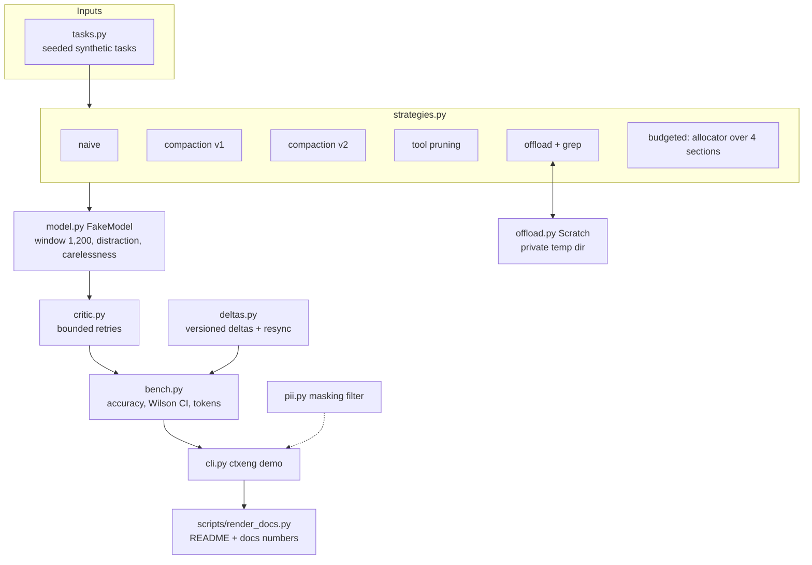

# Architecture

| module | responsibility |
| --- | --- |
| `tokens.py` | word-count tokens, head and tail clipping |
| `budget.py` | floors, weights, output reserve, slack redistribution |
| `tasks.py` | task generator and fact parsers, for both phrasings |
| `model.py` | deterministic fake reader with stated weaknesses |
| `strategies.py` | the six context builders and the shared agent loop |
| `offload.py` | scratch files with safe handles and grep |
| `deltas.py` | full vs delta hand-off, gap detection, resync |
| `critic.py` | stale-value critic, retry cap, cost accounting |
| `pii.py` | masking for logs and errors |
| `bench.py`, `cli.py` | tables printed by `ctxeng demo` |

Key decisions are in [adr/](adr/).
